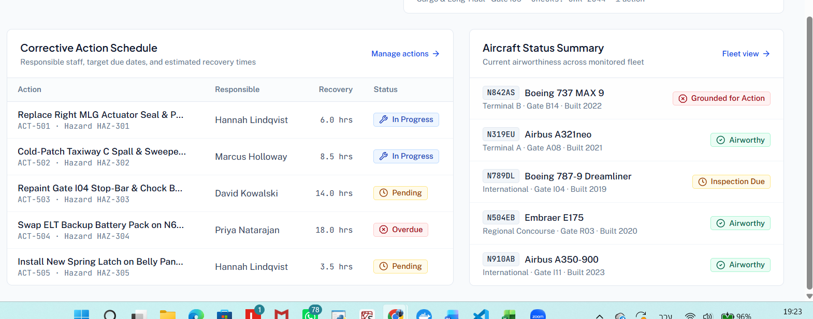
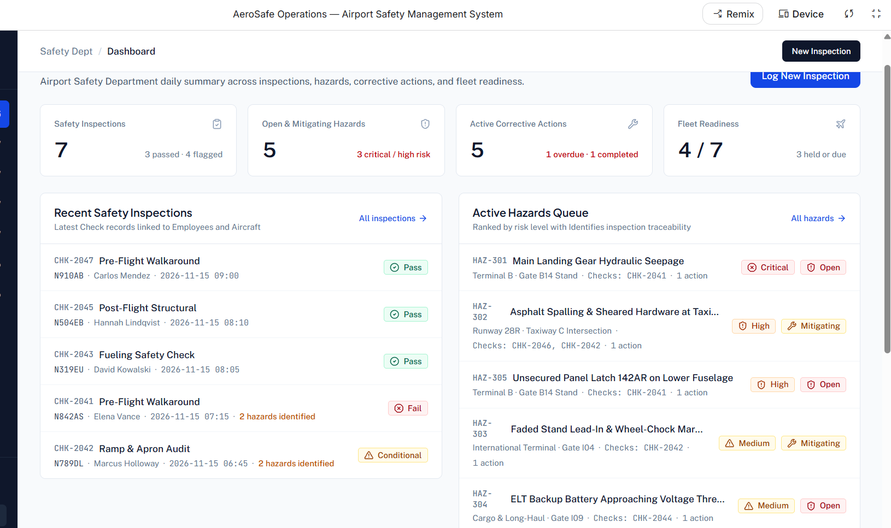
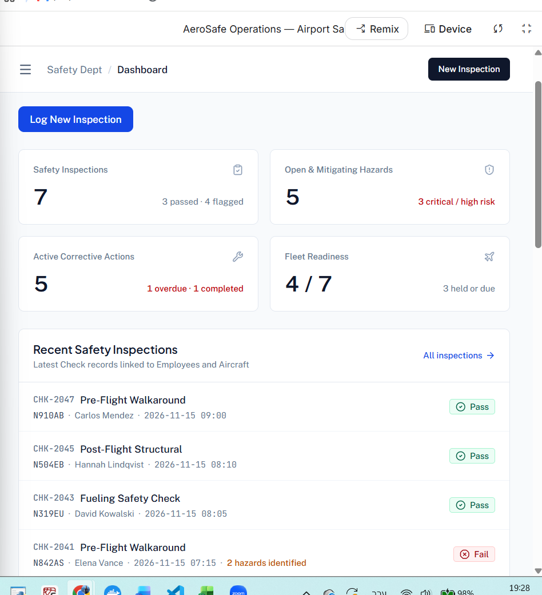
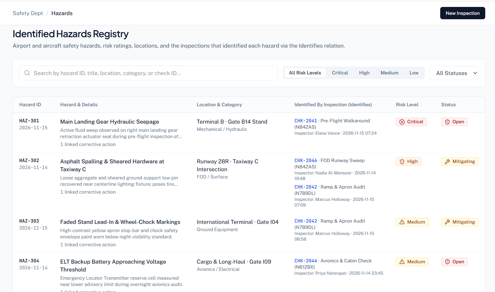
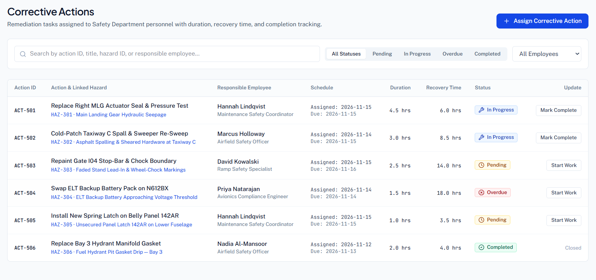
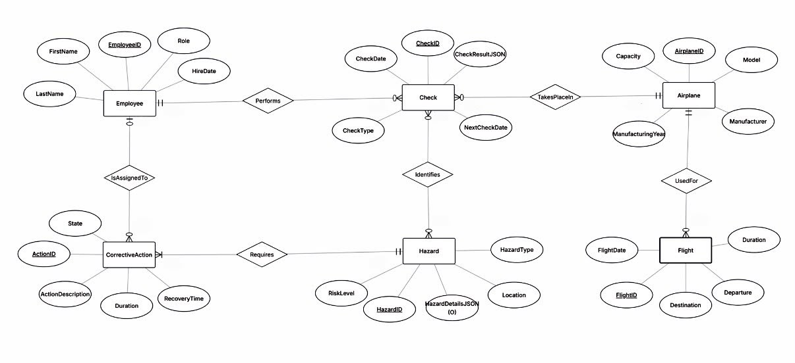
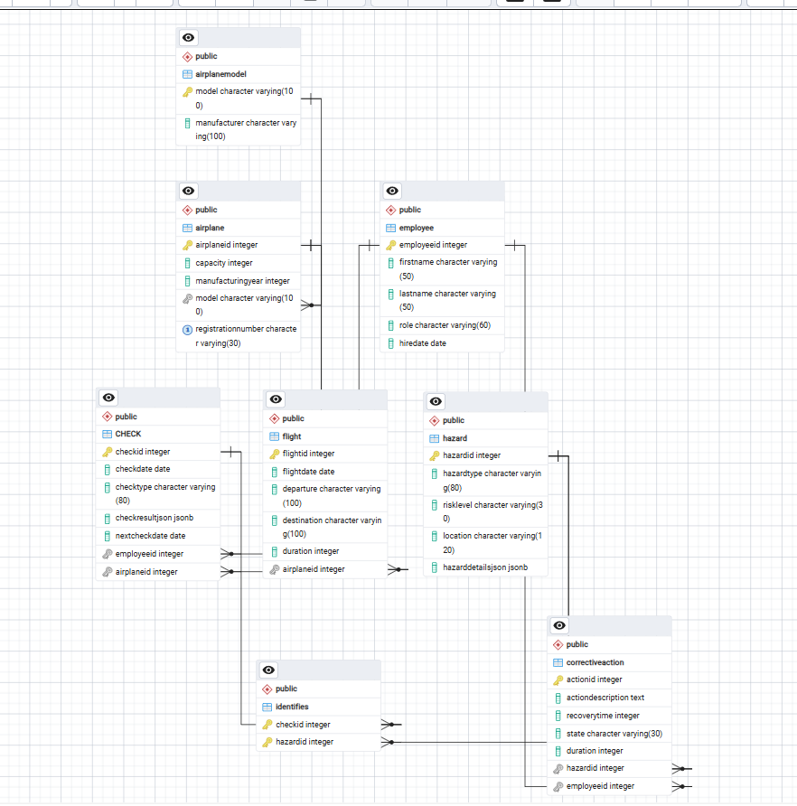

# Airport Safety Management System

## Contents

1. [Project Overview](#1-project-overview)
2. [Database Structure](#2-database-structure)
3. [Database Design and Normalization](#3-database-design-and-normalization)
4. [Data Generation and Population](#4-data-generation-and-population)
5. [Data Integrity Verification](#5-data-integrity-verification)
6. [Database Backup and Restoration](#6-database-backup-and-restoration)
7. [Technologies Used](#7-technologies-used)
8. [Project Files](#8-project-files)
9. [System UI Prototype](#9-system-ui-prototype)
10. [Entity Relationship Diagram](#10-entity-relationship-diagram)
11. [Database Structure Diagram (DSD)](#11-database-structure-diagram-dsd)
12. [Stage 1 Documentation](#12-stage-1-documentation)
13. [Functional Dependencies and Normalization](#13-functional-dependencies-and-normalization)
14. [Stage A Submission](#14-stage-a-submission)

## 1. Project Overview

This project designs and implements a PostgreSQL database for the Safety Department of an airport. The system manages aircraft safety inspections, identified hazards, corrective actions, employee assignments, and flight information.

The design comprises **six main entity tables**, **one relationship table** (`Identifies`), and **one supporting lookup table** (`AirplaneModel`): eight tables in total. The additional lookup table was introduced during normalization.

## 2. Database Structure

| Table | Description |
|---|---|
| Employee | Safety department employees. |
| AirplaneModel | Aircraft models and their manufacturers. |
| Airplane | Individual aircraft, their capacity, manufacturing year, model, and unique registration number. |
| Check | Aircraft safety inspections and structured inspection results. |
| Hazard | Identified safety hazards and optional JSON details. |
| CorrectiveAction | Corrective actions associated with hazards and employees. |
| Flight | Flight information associated with aircraft. |
| Identifies | Relationship between safety inspections and identified hazards. |

Primary keys, foreign keys, and a unique aircraft registration constraint support data integrity. `CheckResultJSON` and `HazardDetailsJSON` use PostgreSQL `JSONB`.

## 3. Database Design and Normalization

The design process included an ERD, conversion to a relational schema, a DSD, identification of functional dependencies, and normalization analysis through 3NF and BCNF. To eliminate the dependency `Model → Manufacturer` from `Airplane`, model/manufacturer information was placed in `AirplaneModel`, with `Airplane.Model` referencing it as a foreign key.

Full functional dependency and normalization explanations are provided in [Section 13](#13-functional-dependencies-and-normalization).

## 4. Data Generation and Population

Synthetic data was originally created using **Mockaroo** (employee CSV), **Excel** (airplane CSV) and **Python** (flight/check/hazard CSV plus `psycopg` inserts for corrective actions and identifies). Extra records were then added via SQL `generate_series` to meet the revised row-count requirements. All 42,905 final records were exported as executable inserts to `שלב א/insertTables.sql`.

### Record counts — Stage A, verified 2026-11-24

| Table | Number of records |
|---|---:|
| Employee | 500 |
| AirplaneModel | 5 |
| Airplane | 500 |
| Flight | 20,000 |
| CHECK | 20,000 |
| Hazard | 550 |
| CorrectiveAction | 600 |
| Identifies | 750 |
| **Total** | **42,905** |

The original normalized snapshot (2026-11-16) contained 3,435 records. `AirplaneModel` is a lookup table with 5 records; clarify with the lecturer whether the 500-record rule applies to it.

For the submission's source files and the three generation methods see **[Stage A submission](שלב%20א/README.md)** and **[data dictionary](שלב%20א/System_Specification.md)**.

## 5. Data Integrity Verification

The original dataset passed SQL checks for four foreign-key relationship groups with **zero invalid references**. After normalization, all 120 original airplanes were matched to their models with zero missing or mismatching model references.

On 2026-11-24 the expanded eight-table dataset was counted in pgAdmin and contained **42,905 rows** in the stated table distribution. A fresh local database named `EFRAT_stageA_verify` was created with `createTables.sql` and loaded successfully with `insertTables.sql`, yielding **42,905 rows**. This is a successful *local schema/data recreation*, not yet a demonstrated backup restore on a different computer.

## 6. Database Backup and Restoration

**Older snapshots** (for traceability):

- `backups/EFRAT_backup.backup` — original 7-table dataset, 3,430 records; successfully restored locally into `EFRAT_restore_test`.
- `backups/EFRAT_stage1_normalized.backup` — normalized snapshot with 8 tables, 3,435 records.

**Updated backups — 2026-11-24, 42,905 records:**

- `backups/stageA_2026-11-24_cli.backup` — created with the `pg_dump` command line.
- `backups/stageA_2026-11-24_gui.backup` — created using pgAdmin GUI.

Both updated backup commands completed successfully and their files were copied into the project. These are **two interfaces to PostgreSQL backup**, as requested (CLI and GUI). A restore of the *new* backup on **another computer** is still required by the lecturer and has not yet been documented.

Screenshots are included in **[Stage A](שלב%20א/README.md#8-backups-and-recovery)**.

## 7. Technologies Used

PostgreSQL, pgAdmin, Docker, Python (`psycopg`), SQL, Microsoft Excel, Mockaroo, Git, GitHub, and Google AI Studio (UI prototype).

## 8. Project Files

The latest stage submission is organized in **[`שלב א/`](שלב%20א/README.md)**. It includes:

- `createTables.sql` — 8 normalized tables; `dropTables.sql` — 8 drop commands.
- `insertTables.sql` — 42,905 generated `INSERT` statements; `selectAll.sql` — select queries.
- `Programing/` — existing Python sources and the incremental SQL generation script.
- `DataImportFiles/` — CSV data files; `mockarooFiles/` — original Mockaroo employee CSV.
- `Screenshots/` — diagrams, AI Studio prototype images, and verification/backup evidence.
- `Backups/` — two new 2026-11-24 backup files.
- `System_Specification.md` — screen specifications and full data dictionary.

Original development files remain in `init-db/`, `docs/` and `backups/` and have not been deleted. Sensitive `.env` stays local and must not be committed.

## 9. System UI Prototype

An interactive mock interface was created using Google AI Studio. It illustrates planned dashboards, safety inspections, hazard management, and corrective action tracking. **This prototype uses sample data and is not connected to PostgreSQL.** Some displayed functions are prospective features rather than implemented database fields.

### Dashboard

### Safety Inspections

### Hazard Management

### Corrective Actions

## 10. Entity Relationship Diagram

The original ERD was created using ERDPlus to show the six main entities and their relationships. The supporting `AirplaneModel` table was introduced later in relational normalization, so the original ERD and the normalized DSD are not identical.

## 11. Database Structure Diagram (DSD)

This DSD depicts the **updated eight-table physical schema**, including primary and foreign keys, the `AirplaneModel` relationship, and the aircraft registration field.

## 12. Stage 1 Documentation

The following PDF provides screenshots and explanations of the data generation/import methods, integrity verification, original backup, and restoration process. It was prepared before the additional normalization step described in this README.

[View Stage 1 Documentation](docs/Stage1_Documentation.pdf)

## 13. Functional Dependencies and Normalization

### 13.1 Employee

**Relation:**

Employee(EmployeeID, FirstName, LastName, Role, HireDate)

**Primary Key:** EmployeeID

**Functional Dependency:**

EmployeeID → FirstName, LastName, Role, HireDate

**Normalization Analysis:**

- **1NF:** Each employee is uniquely identified by EmployeeID, and the attributes contain single values.

- **2NF:** The primary key consists of a single attribute, so there are no partial dependencies.

- **3NF:** Assuming no additional business-rule dependencies, all non-key attributes depend directly on EmployeeID.

- **BCNF:** Under the same assumption, EmployeeID is the determinant of every non-trivial functional dependency and is a superkey.

**Conclusion:** The Employee relation satisfies BCNF under the stated functional dependency assumptions.

### 13.2 AirplaneModel

**Relation:**

AirplaneModel(Model, Manufacturer)

**Primary Key:** Model

**Functional Dependency:**

Model → Manufacturer

**Normalization Analysis:**

- 1NF: All attributes contain atomic values.

- 2NF: The primary key consists of one attribute.

- 3NF: There are no transitive dependencies.

- BCNF: Model is a superkey and determines Manufacturer.

**Conclusion:** AirplaneModel satisfies BCNF.

### 13.3 Airplane

**Relation:**

Airplane(AirplaneID, Capacity, ManufacturingYear,

Model, RegistrationNumber)

**Primary Key:** AirplaneID

**Alternative Candidate Key:** RegistrationNumber

**Foreign Key:** Model references AirplaneModel(Model).

**Functional Dependencies:**

AirplaneID → Capacity, ManufacturingYear,

Model, RegistrationNumber

RegistrationNumber → AirplaneID, Capacity,

ManufacturingYear, Model

**Normalization Analysis:**

- 1NF: All attributes contain atomic values.

- 2NF: There are no partial dependencies.

- 3NF: There are no transitive dependencies under

  the stated business assumptions.

- BCNF: Every non-trivial functional dependency

  has a superkey as its determinant.

**Business Assumption:**

Capacity describes the seating configuration of

an individual airplane and is not necessarily

determined by its model.

**Conclusion:**

Under these business assumptions, Airplane

satisfies BCNF.

Manufacturer was moved to AirplaneModel to

eliminate the transitive dependency:

AirplaneID → Model → Manufacturer

### 13.4 Flight

**Relation:**

Flight(FlightID, FlightDate, Departure,

Destination, Duration, AirplaneID)

**Primary Key:** FlightID

**Foreign Key:** AirplaneID references Airplane(AirplaneID).

**Functional Dependency:**

FlightID → FlightDate, Departure, Destination,

Duration, AirplaneID

**Normalization Analysis:**

- 1NF: All attributes contain atomic values.

- 2NF: The primary key consists of a single attribute,

  so there are no partial dependencies.

- 3NF: There are no transitive dependencies under

  the stated business assumptions.

- BCNF: Every non-trivial functional dependency

  has a superkey as its determinant.

**Business Assumption:**

Duration represents the duration of an individual

flight and may vary between flights on the same route.

**Conclusion:**

Under these assumptions, Flight satisfies BCNF.

### 13.5 Check

**Relation:**

Check(CheckID, CheckDate, CheckType,

CheckResultJSON, NextCheckDate,

EmployeeID, AirplaneID)

**Primary Key:** CheckID

**Foreign Keys:**

- EmployeeID references Employee(EmployeeID).

- AirplaneID references Airplane(AirplaneID).

**Functional Dependency:**

CheckID → CheckDate, CheckType, CheckResultJSON,

NextCheckDate, EmployeeID, AirplaneID

**Normalization Analysis:**

- 1NF: Each row represents one safety inspection.

  The JSONB result is stored as a single attribute.

- 2NF: The primary key consists of one attribute,

  so there are no partial dependencies.

- 3NF: Under the stated business assumptions,

  there are no transitive dependencies.

- BCNF: Every non-trivial functional dependency

  has a superkey as its determinant.

**Business Assumptions:**

Each inspection has its own scheduled dates,

assigned employee, airplane, type, and results.

NextCheckDate is determined for each individual

inspection and is not necessarily determined

by CheckType alone.

**Conclusion:**

Under these assumptions, Check satisfies BCNF.

### 13.6 Hazard

**Relation:**

Hazard(HazardID, HazardType, RiskLevel,

Location, HazardDetailsJSON)

**Primary Key:** HazardID

**Functional Dependency:**

HazardID → HazardType, RiskLevel,

Location, HazardDetailsJSON

**Normalization Analysis:**

- 1NF: Each row represents one hazard.

  The JSONB field is treated as a single

  structured attribute in PostgreSQL.

- 2NF: The primary key consists of one

  attribute, so there are no partial dependencies.

- 3NF: There are no transitive dependencies

  under the stated business assumptions.

- BCNF: Every non-trivial functional dependency

  has a superkey as its determinant.

**Business Assumptions:**

RiskLevel is assigned to each individual hazard

and is not necessarily determined by HazardType.

Location represents the location of the specific

hazard and does not determine its other attributes.

HazardDetailsJSON contains additional information

about the hazard and is not used to duplicate

relational keys or create hidden dependencies.

**Conclusion:**

Under these assumptions, Hazard satisfies BCNF.

### 13.7 CorrectiveAction

**Relation:**

CorrectiveAction(ActionID, ActionDescription,

RecoveryTime, State, Duration, HazardID, EmployeeID)

**Primary Key:** ActionID

**Foreign Keys:**

- HazardID references Hazard(HazardID).

- EmployeeID references Employee(EmployeeID).

**Functional Dependency:**

ActionID → ActionDescription, RecoveryTime,

State, Duration, HazardID, EmployeeID

**Normalization Analysis:**

- 1NF: Each row represents one corrective action,

  and its attributes contain atomic values.

- 2NF: The primary key consists of one attribute,

  so there are no partial dependencies.

- 3NF: There are no transitive dependencies

  under the stated business assumptions.

- BCNF: Every non-trivial functional dependency

  has a superkey as its determinant.

**Business Assumptions:**

Each corrective action has its own description,

duration, recovery time, and current state.

Different corrective actions may be assigned to

the same employee or address the same hazard.

Neither EmployeeID nor HazardID alone determines

the other attributes of a corrective action.

**Conclusion:**

Under these assumptions, CorrectiveAction

satisfies BCNF.

### 13.8 Identifies

**Relation:**

Identifies(CheckID, HazardID)

**Composite Primary Key:** (CheckID, HazardID)

**Foreign Keys:**

- CheckID references Check(CheckID).

- HazardID references Hazard(HazardID).

**Functional Dependency:**

(CheckID, HazardID) → All attributes of Identifies

The composite key uniquely identifies each

inspection-hazard relationship.

**Normalization Analysis:**

- 1NF: Each row contains one CheckID and one

  HazardID, both holding atomic values.

- 2NF: There are no non-key attributes that

  could depend on only part of the composite key.

- 3NF: There are no transitive dependencies.

- BCNF: The composite key is a superkey, and

  there are no non-trivial functional dependencies

  with a non-superkey determinant.

**Business Assumptions:**

One inspection may identify several hazards,

and one hazard may be identified by several

inspections.

The combination of CheckID and HazardID is

unique, preventing duplicate relationships.

**Conclusion:**

Identifies satisfies BCNF.

### 13.9 Overall Normalization Summary

All eight relations were analyzed for functional

dependencies and normalization.

Under the documented business assumptions,

all relations satisfy BCNF and therefore also 3NF.

The Airplane relation was decomposed into

Airplane and AirplaneModel to eliminate the

transitive dependency:

AirplaneID → Model → Manufacturer

This decomposition reduces data redundancy

and helps prevent update anomalies.

## 14. Stage A Submission

[Open the complete Stage A submission folder](שלב%20א/README.md).

The latest database state is **8 tables / 42,905 rows** (verified 2026-11-24). An updated **data dictionary**, the **four required SQL files**, method-specific source folders, screenshots and two dated backups are included. Before final submission add the student names/IDs, a real Google AI Studio link, a current ERDPlus source and separate-computer restore evidence; confirm the lookup-table row requirement and create a Git TAG.
