# Airport Safety Management System — Stage A Submission

**System:** Airport Safety Management System
**Department:** Airport Safety Department
**Submitted by:** [Efrat Kraytenberger]; [Hila Brand]
**Stage:** A — Design, Database Creation, Population, Backup
**Updated:** 2026-11-24

## 1. Introduction

## 2. Four-screen UI prototype

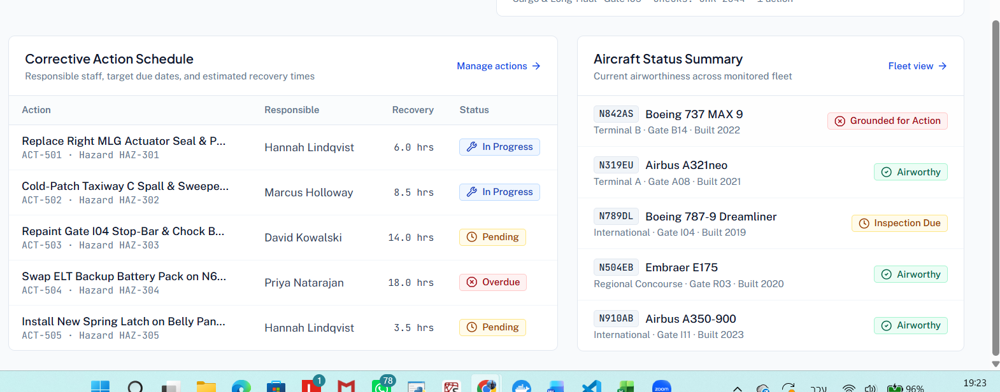

## 3. ERD and DSD

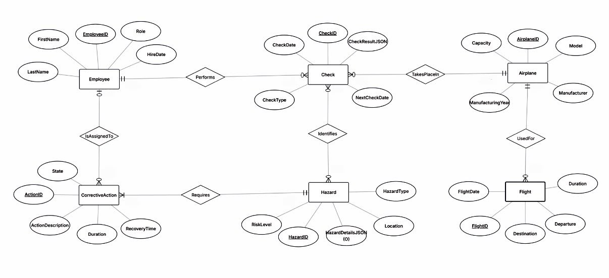
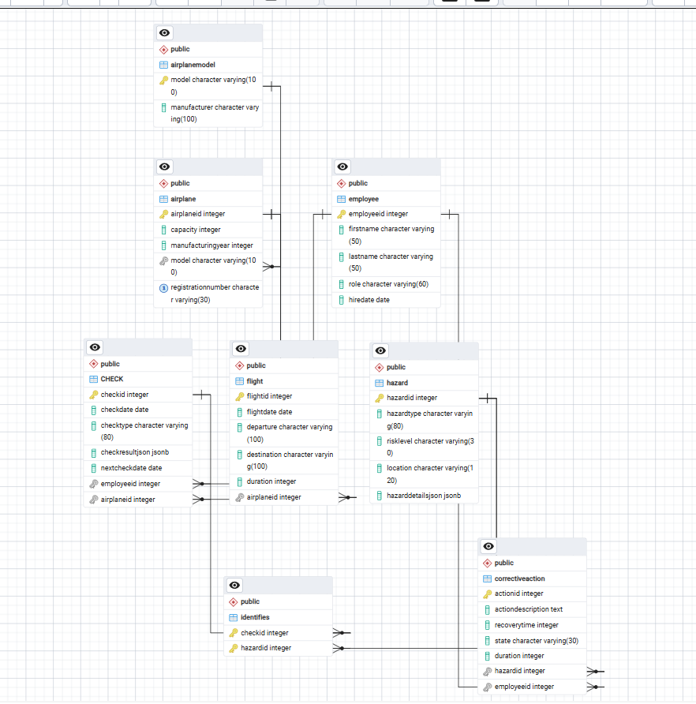

4. [Data dictionary and normalization](#4-data-dictionary-and-normalization)
5. [Data generation methods](#5-data-generation-methods)
6. [Row counts and integrity checks](#6-row-counts-and-integrity-checks)
7. [SQL files and reproducibility](#7-sql-files-and-reproducibility)
8. [Backups and recovery](#8-backups-and-recovery)
9. [Remaining lecturer requirements](#9-remaining-lecturer-requirements)

## 1. Introduction

The project models safety operations for an airport department: workers inspect aircraft, inspections identify hazards, corrective actions address hazards, and flights refer to aircraft. The final normalized PostgreSQL design includes six core entities, an inspection–hazard association table (`Identifies`), and an aircraft-model lookup table (`AirplaneModel`) — **eight tables**.

## 2. Four-screen UI prototype

Built in Google AI Studio as a **standalone demonstration**; it is not connected to PostgreSQL.

### Dashboard

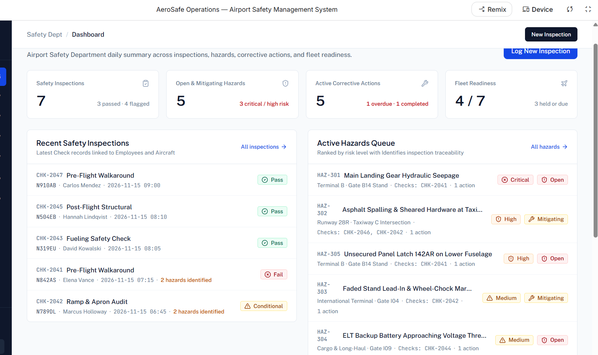

### Inspections

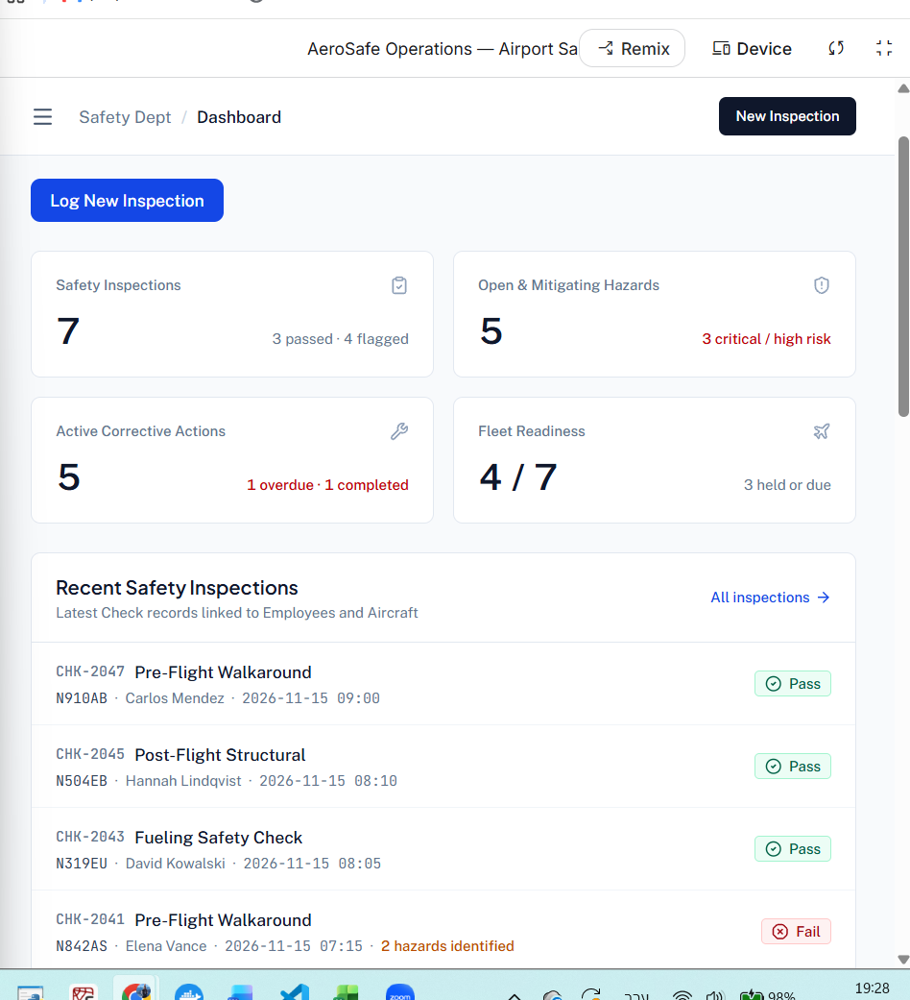

### Hazards

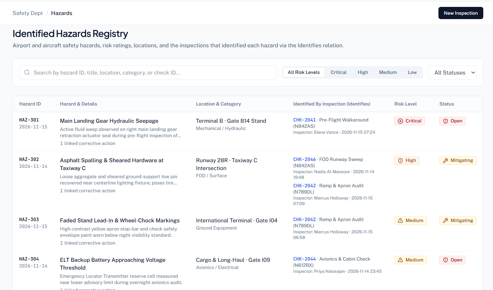

### Corrective actions

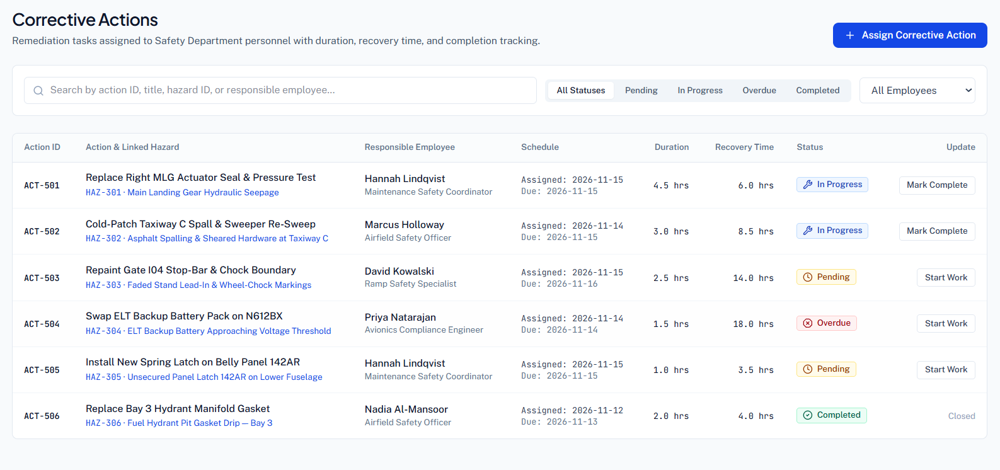

## 3. ERD and DSD

The conceptual ERD covers six core entities and their relationships. A normalized schema adds `AirplaneModel` to the relational design. The physical DSD depicts all eight database tables.

**Check before final submission:** ERD and DSD should reflect the same final design as required by the lecturer; the original ERD screenshot predates the aircraft-model normalization. Include the editable `.erdplus` source if available.

## 4. Data dictionary and normalization

The full field-by-field data dictionary, SQL types, constraints, PK/FK relationships, screen descriptions, and normalization rationale are provided in [System_Specification.md](System_Specification.md).

Core example: the functional dependency `Model → Manufacturer` motivated splitting model/manufacturer information into a separate `AirplaneModel` table, linked by `Airplane.Model`. The remaining relations were analyzed to 3NF/BCNF **subject to documented business assumptions**. See also the main repository README normalization section.

## 5. Data generation methods

Three originally used approaches, supplemented with SQL to reach the new required volume:

| Method | Usage | Submitted artifacts |
|---|---|---|
| Mockaroo | Initially generated 60 synthetic employee records | `mockarooFiles/MOCK_DATA.csv` |
| Excel + CSV import | Initially generated 120 airplanes | `DataImportFiles/airplane_data.csv` and other CSV exports |
| Python / psycopg | Generated flights, checks and hazards as CSV; inserted corrective actions and identifies directly | `Programing/*.py` and CSV files |
| SQL generation / export (additional) | Added employees to 500, airplanes to 500, flights and CHECK to 20,000 each; exported 42,905 rows as SQL INSERT statements | `Programing/02-seed-data.sql`, `insertTables.sql` |

**Important:** the small original CSV files still represent the original generation methods. The final full dataset is captured in `insertTables.sql` and the dated backups. The `02-seed-data.sql` file contains **incremental SQL additions only** and is not a standalone full loader.

**Historic screenshots of generation, original backup and restore:** [Stage 1 Documentation PDF](Screenshots/Stage1_Documentation.pdf).

## 6. Row counts and integrity checks

Verified in pgAdmin on `EFRAT_restore_test` after population, on 2026-11-24:

| Table | Rows |
|---|---:|
| Employee | 500 |
| Airplane | 500 |
| AirplaneModel | 5 |
| Flight | 20,000 |
| CHECK | 20,000 |
| Hazard | 550 |
| CorrectiveAction | 600 |
| Identifies | 750 |
| **Total** | **42,905** |

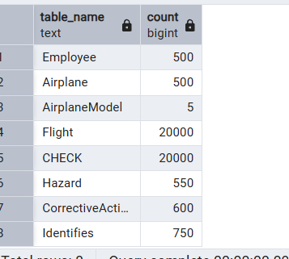

Four referential-integrity checks on the original data returned zero invalid references. The subsequent large data load completed under the database's foreign-key constraints. A fresh local database, `EFRAT_stageA_verify`, was successfully created using `createTables.sql` and loaded from `insertTables.sql` to **42,905** rows.

## 7. SQL files and reproducibility

| File | Purpose |
|---|---|
| `createTables.sql` | Create 8 tables, including keys and constraints |
| `insertTables.sql` | Full data-only dump with 42,905 row inserts; use on an **empty schema** |
| `selectAll.sql` | Read data from each of the 8 tables |
| `dropTables.sql` | Drop all 8 tables in dependency-safe order; **destructive** |

**Recommended verification sequence:** Create a separate empty PostgreSQL database, run `createTables.sql`, then `insertTables.sql`, and finally selected count queries or `selectAll.sql`. Do not rerun the full inserts on the populated original database. The schema and full inserts were tested successfully on a separate local database.

**Do not use** `dropTables.sql` on any database that contains data you want to keep.

## 8. Backups and recovery

On **2026-11-24**, two backups of the updated `EFRAT_restore_test` database were created:

| Backup | Method |
|---|---|
| `Backups/stageA_2026-11-24_cli.backup` | `pg_dump` command line (Custom format) |
| `Backups/stageA_2026-11-24_gui.backup` | pgAdmin graphical backup (Custom format) |

Earlier backup files, if present, are historical and contain fewer records. The two new backups were created successfully and copied into the project.

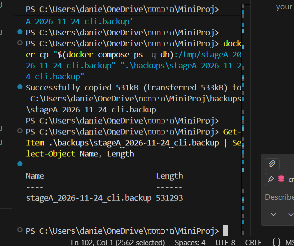

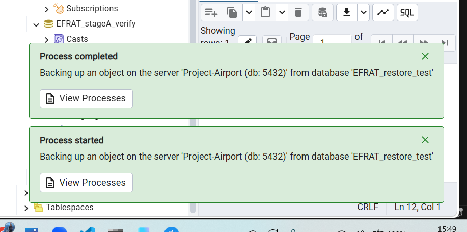

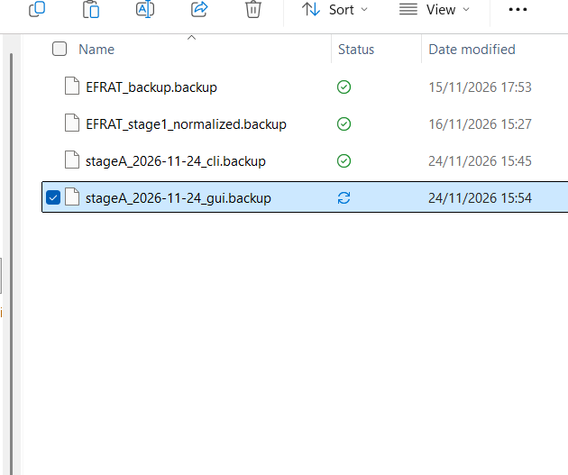

**Recovery validation:** The original backup was restored into a separate local database. The final SQL create/insert artifacts were also tested on a fresh **local** database with 42,905 records. However, **restoring the new backup on a different computer has not yet been verified** and remains an explicit lecturer requirement.

## 9. Remaining lecturer requirements

- [ ] Fill in the two student names, requested ID digits and GitHub repository naming convention.
- [ ] Add a real public/shared Google AI Studio project link.
- [ ] Include an updated editable ERDPlus file and align the final ERD and DSD.
- [ ] Clarify whether the 500-row requirement applies to the 5-row lookup `AirplaneModel` table.
- [ ] Demonstrate restoring one of the newest backups on **another computer** and add actual evidence.
- [ ] Confirm the lecturer's required screenshots for each generation method are visible in the submitted report.
- [ ] Commit/push the finished submission folder and create the required Git TAG for Stage A.

Database credentials in `.env` are **not** included and must not be pushed to GitHub.
